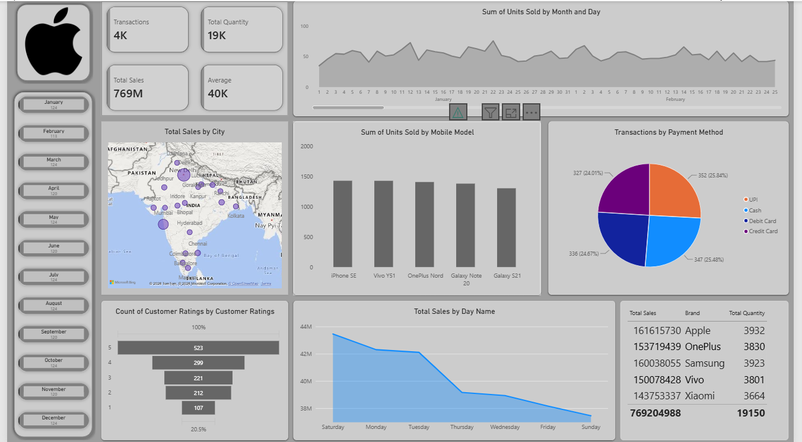

# 📊 Mobile Sales Analysis Dashboard – Power BI

## About the Project

I built this dashboard using Power BI to explore mobile sales data and understand how sales are performing across different brands, models, cities, and payment methods.

The idea behind this project was to take raw sales data and turn it into an interactive dashboard where different aspects of the business can be explored easily.

## Tools Used

- **Power BI** – For creating the dashboard and visualizations.
- **Power Query** – For cleaning and transforming the data.
- **DAX** – For creating calculations and KPI measures.

## What I Worked On

While building this dashboard, I focused on the following areas:

- **Sales Overview:** Created KPI cards to display total sales, transactions, quantity sold, and average value.
- **Sales Trends:** Analyzed sales patterns across months, dates, and days of the week.
- **City-wise Sales:** Used a map to explore sales distribution across different cities.
- **Product Analysis:** Compared mobile brands and models based on units sold.
- **Customer Analysis:** Explored customer ratings and preferred payment methods.
- **Interactive Filtering:** Added a monthly slicer to make it easier to explore the data for different months.

## Dashboard Preview

<!-- Add your dashboard screenshot below -->

## Files in This Repository

| File | Description |
|---|---|
| `Mobile_Sales_Dashboard.pbix` | Power BI report file |
| `Mobile_Sales_DashBoard.png` | Screenshot of the dashboard |
| `README.md` | Project documentation |

## What I Learned

Working on this project gave me practical experience with Power BI, especially in creating DAX measures, working with Power Query, choosing appropriate visualizations, and designing an interactive dashboard.

I'm continuing to improve my data analysis skills and looking forward to working on more projects.

---

⭐ Thanks for checking out my project!
